# Lympha Atl — Arquitectura completa del sistema

> Documento de referencia de **cómo está construido** Lympha Atl (hackathon Puebla 2026). Describe el sistema tal como existe en el código a **2026-11-18**.
> Para el diseño original y sus razones, ver [`ARQUITECTURA.md`](./ARQUITECTURA.md) (la especificación de partida); para las decisiones paso a paso, [`decisiones.md`](./decisiones.md); para el proceso de trabajo, [`METODOLOGIA_DE_DESARROLLO.md`](./METODOLOGIA_DE_DESARROLLO.md).
> Todos los diagramas son [Mermaid](https://mermaid.js.org/): se ven en GitHub, en VS Code (extensión *Markdown Preview Mermaid Support*) y en la mayoría de visores de Markdown.

---

## 1. Qué es Lympha Atl

**Lympha Atl** («Atl» = *agua* en náhuatl) es la versión **comunitaria** de Lympha: vigilancia continua y reportes de la calidad del agua para escuelas, comités de agua, cisternas compartidas y hogares. Un nodo con sensor mide el pH, lo publica en **Blynk**; el servidor lo lee, lo evalúa, **guarda la historia en MongoDB**, avisa por **Telegram** y genera un **reporte PDF** con base en la NOM-127. Una persona responsable puede, además, pedir un pulso de dosificación que **solo ocurre si otra confirmación humana lo autoriza**.

Tres ideas gobiernan todo el diseño:

| Idea | Qué significa en la práctica |
|---|---|
| **Dirigido por configuración** | Parámetros, límites, reglas y pines viven en `server/config/parametros.json` y en el documento del nodo. Cambiar de sensor es agregar una entrada, no cambiar la lógica. |
| **Honestidad del producto** | Nunca se dice «potable» ni «seguro». El reporte incluye la **cobertura de datos** y lista **lo que no se midió**. Si Blynk o el nodo no responden, se registra el hueco y no se inventa nada. |
| **El actuador es seguro por diseño** | El firmware decide los enclavamientos; la nube **nunca sube la dosis sola**: recomienda y una persona confirma. Lo automático es solo detener y avisar. |

**Qué no es:** no certifica el agua. Un sensor de pH no demuestra el cumplimiento de la NOM-127.

### 1.1 Cómo se llama esta arquitectura

Con nombres **establecidos** (no inventados), Lympha Atl es:

> **Un monolito modular con arquitectura hexagonal (puertos y adaptadores).**

| Nombre | Qué es | Dónde se ve en Atl |
|---|---|---|
| **Arquitectura hexagonal / Ports & Adapters** (Alistair Cockburn, 2005) | La lógica de la aplicación queda en el centro; las **interfaces (puertos)** están dentro de la aplicación y las **implementaciones técnicas (adaptadores)** fuera. Hay puertos de entrada (*driving*) y de salida (*driven*). El hexágono es solo una forma de dibujarlo | `modulos/` define los puertos (`LectorNodo`, `AlmacenIngesta`, `AlmacenAlertas`…); `plataforma/` trae los adaptadores (Blynk, Mongo, Telegram, Firebase, PDF). Entradas: API REST, bot de Telegram, CLI y bucles |
| **Monolito modular** (estilo de despliegue) | Una sola unidad desplegable con módulos de fronteras claras | Un proceso Node con módulos que solo se hablan por su `index.ts` |
| **Functional Core, Imperative Shell** (Gary Bernhardt, 2012) | Un núcleo de funciones puras y una capa exterior que se ocupa de los efectos | `evaluacion/`, `dominio/`, `decidirCiclo` y las reglas de alertas y del actuador son puros; el I/O vive en los adaptadores |

**Patrones de diseño que lo acompañan** (también con nombre establecido):

| Patrón | Dónde |
|---|---|
| **Outbox con polling publisher** | La bandeja de avisos (`avisos`) y su enviador independiente. *Matiz honesto:* la versión clásica escribe el evento en la misma transacción que el dato; aquí la alerta y su aviso se escriben en operaciones idempotentes con **clave única**, no en una transacción multidocumento |
| **Polling** (sondeo) | El poller de Blynk consulta cada 5 s en vez de recibir webhooks |
| **Receptor idempotente** | Insertar muestras con índice único; reintentar no duplica |
| **Bucle de reconciliación** | Las alertas comparan el estado *deseado* con el *actual* y corrigen la diferencia |
| **Borrado lógico** (*soft delete*) | Quitar un nodo lo archiva y conserva el historial |

Lo que **no** es: no es microservicios (no hay servicios separados ni un broker), no es *event sourcing* ni CQRS, y no es una arquitectura en capas clásica (la dependencia apunta hacia el núcleo, no hacia abajo).

---

## 2. Contexto del sistema

Quién interactúa con Atl y con qué sistemas externos se integra.

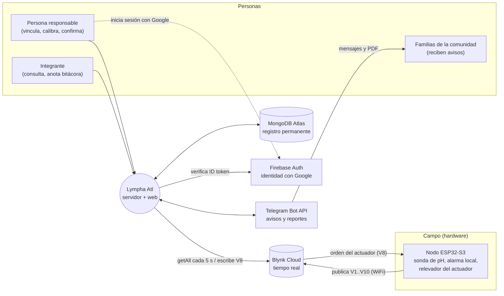

Puntos importantes:

- **Blynk es la capa de tiempo real; MongoDB es la memoria.** Blynk conserva el último valor de cada pin aunque la placa se apague; por eso Atl usa un contador `seq` como señal de vida.
- **El servidor no se conecta a la placa.** Solo habla con la API HTTP de Blynk.
- **Firebase solo identifica.** No hay contraseñas ni sesiones propias: el servidor únicamente **verifica** el ID token.

---

## 3. Vista de contenedores y despliegue

Hoy todo corre **en local** (no hay VPS): un solo proceso de servidor Node, una SPA con Vite y servicios gestionados en la nube.

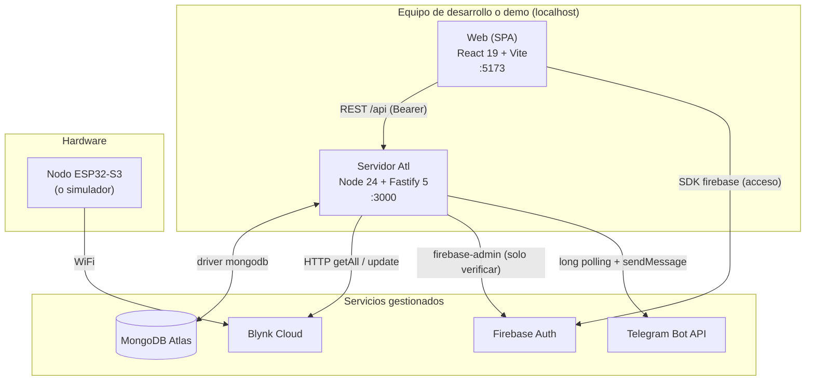

| Contenedor | Tecnología | Notas |
|---|---|---|
| **Web** | Vite + React 19, CSS con tokens (`design/tokens.css`), gráfica con **MUI X Charts** | Cuatro pantallas: Entrar, Mi agua, Reportes y Comunidad. Sin CDN: fuentes y librerías autoalojadas. |
| **Servidor** | Node 24 (TypeScript directo, sin paso de build), Fastify 5 + `fastify-type-provider-zod`, driver `mongodb`, `pdfkit`, `pino` | **Un solo proceso** con varios bucles internos (sección 4). |
| **Base de datos** | MongoDB Atlas (plan B: Mongo local en Docker; el código es idéntico) | Documentos de forma flexible: no hay migraciones. |
| **Simulador** | `pnpm simulador` (escribe en Blynk como lo haría el nodo) | Permite probar toda la cadena sin hardware. |
| **Humo (smoke)** | `pnpm smoke` | Recorre la cadena real de punta a punta con datos propios y los borra. |

Arranque conjunto: desde `hackathon/`, `pnpm --ignore-workspace dev` levanta servidor y web y los detiene con Ctrl+C.

---

## 4. Procesos dentro del servidor

Un único proceso (`server/src/main.ts`) compone los módulos y arranca seis actividades concurrentes. Todas se detienen en orden con `SIGINT`/`SIGTERM`.

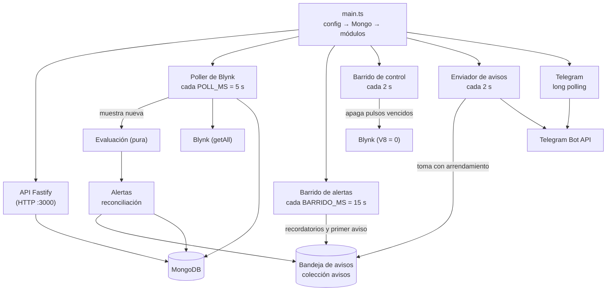

Reglas de diseño del proceso:

- **Cada actividad es un bucle secuencial** (`plataforma/bucle.ts`): una ronda nunca se solapa con la siguiente.
- **Un nodo que falla no frena a los demás**: el poller aplica espera exponencial por nodo (con tope de 60 s).
- Se pueden apagar piezas por configuración: `INGESTA_ACTIVA=false` (solo API), sin `TELEGRAM_BOT_TOKEN` (los avisos esperan en la bandeja) y `ACTUADOR_ESCRIBE_BLYNK=false` (el actuador se ensaya sin mover nada).

---

## 5. Arquitectura por capas (puertos y adaptadores)

El código separa **lo que se decide** (puro, con pruebas) de **lo que toca el mundo** (red y base de datos).

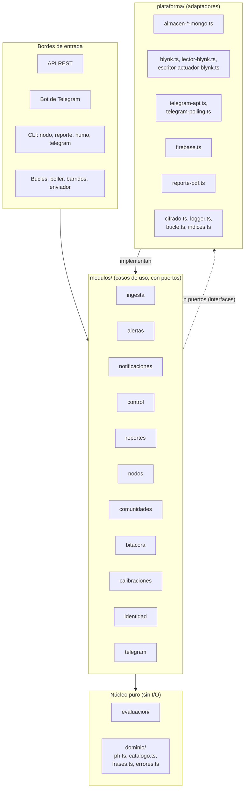

**Reglas que se cumplen (y se prueban o se verifican con el linter):**

1. Cada módulo expone un `index.ts`; **nadie importa archivos internos de otro módulo**.
2. `evaluacion/` y `dominio/` son **funciones puras**: sin red, sin base de datos, con pruebas unitarias.
3. **Solo `plataforma/blynk.ts` habla con Blynk** (a través de las interfaces `LectorNodo` y del escritor del actuador): cambiar de plataforma es reemplazar un adaptador.
4. Toda entrada se valida con **zod `.strict()`**: cuerpos, parámetros, variables de entorno y el catálogo. Si falta una variable de entorno, el proceso no arranca.
5. Los errores de dominio son **clases tipadas** que la capa HTTP traduce; jamás se exponen trazas.

### 5.1 Módulos

| Módulo | Responsabilidad |
|---|---|
| `ingesta` | Sondea Blynk, decide si hay muestra nueva (`seq`), evalúa, guarda y avisa a alertas. Incluye el ciclo puro `decidirCiclo`. |
| `evaluacion` | Reglas por parámetro (rango, margen, histéresis, cambio rápido, estabilidad, sensor degradado). Puro. |
| `alertas` | Reconcilia el estado deseado contra las alertas abiertas; recordatorios; textos de aviso. |
| `notificaciones` | Bandeja de avisos (outbox) y su enviador con arrendamiento y reintentos. |
| `telegram` | Vinculación por enlace, `/estado`, `/reporte`, `/ayuda`, `/desvincular`. |
| `control` | Actuador: pedir → confirmar → pulso → apagado, con enclavamientos y registro. |
| `reportes` | Estadísticas, contenido y huella del reporte; el PDF lo dibuja `plataforma/reporte-pdf.ts`. |
| `nodos` | Alta (valida el token de Blynk), edición, quitar y restaurar (borrado lógico), series y eventos. |
| `comunidades` | Comunidades, miembros y roles; vinculación de Telegram. |
| `bitacora` | Notas humanas que entran al reporte. |
| `calibraciones` | Registro de calibraciones (hechas por una persona o reportadas por el nodo). |
| `identidad` | Verificación del token de Firebase y usuario de demostración. |
| `api` | Rutas REST, CORS, salud, autenticación y cabeceras. |

---

## 6. Dominio y configuración

### 6.1 Catálogo de parámetros

`server/config/parametros.json` (validado con zod al arrancar) describe cada parámetro: nombre, unidad, norma (mínimo y máximo), decimales, pines de Blynk y **reglas de evaluación como datos**. Agregar «turbidez» u «ORP» es agregar una entrada; no hay `if (parametro === "ph")` fuera de `dominio/ph.ts`, que concentra lo específico del pH: la ecuación de Nernst, la calibración de 2 puntos y la fracción de HOCl.

### 6.2 Pines de Blynk (contrato con el firmware)

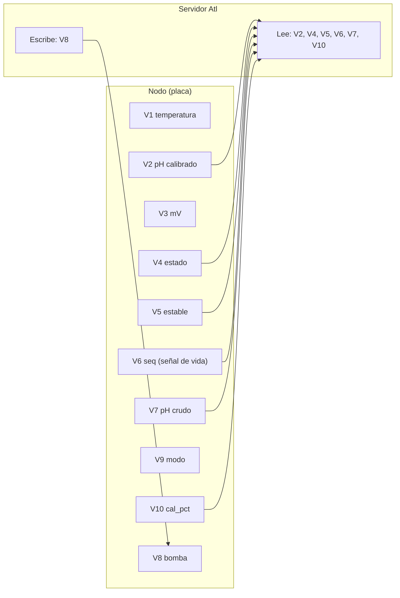

Hoy Atl **no guarda** V1 (temperatura), V3 (mV) ni V9 (modo); se ven en la app de Blynk. El mapeo vive en el documento del nodo, así que un pin distinto es configuración.

---

## 7. Flujos principales

### 7.1 Ingesta: de Blynk a la base

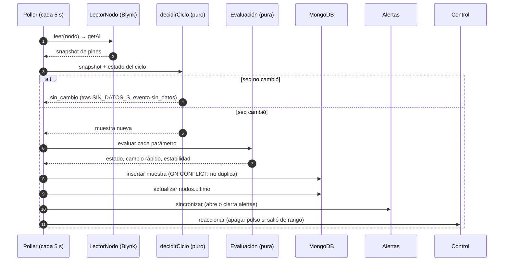

Garantías:

- **`seq` es la señal de vida.** Si no cambia, Blynk solo conserva un valor viejo: no se inserta una muestra, y tras `SIN_DATOS_S` (60 s) se abre la alerta «sin conexión».
- **Idempotencia:** una muestra repetida (mismo nodo, sesión y `seq`) se omite. Si `seq` baja, es un reinicio de la placa y se abre una *sesión* nueva.
- **Escrituras con reintento:** si Mongo cae, las escrituras esperan en memoria (hasta 200 por nodo) y se aplican **en orden** al volver; al desbordarse se descarta lo más antiguo y se registra.
- **El orden importa:** la muestra se guarda antes de las operaciones secundarias (calibración, alertas) para que un fallo posterior no frene el dato.

### 7.2 Estados del agua

La evaluación es genérica: todo sale de la norma y las reglas del catálogo. El estado general del nodo es el **peor** de sus parámetros.

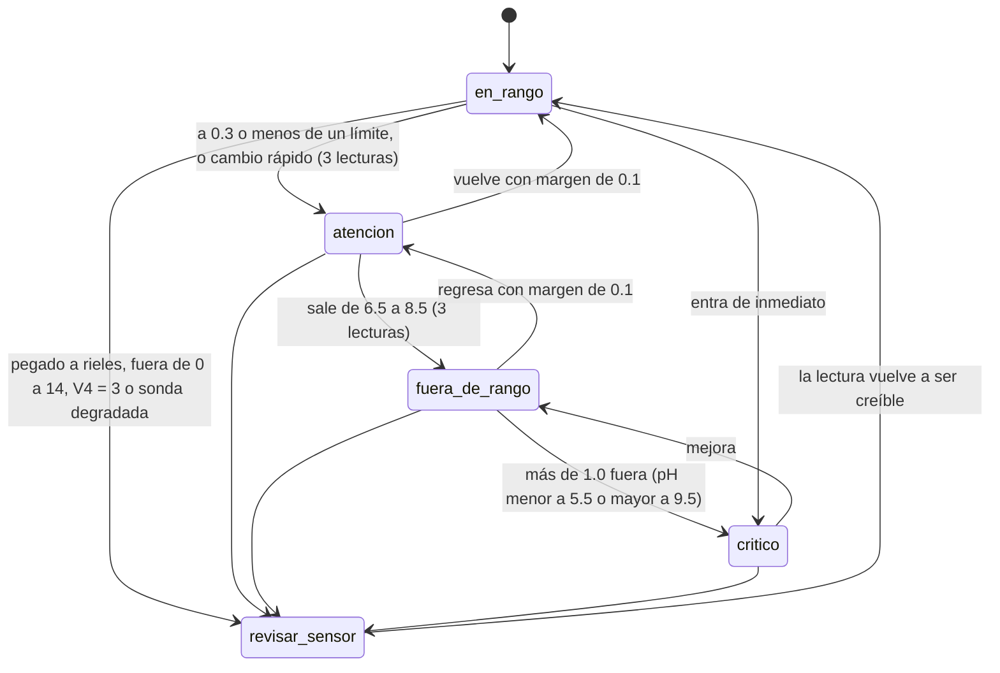

Además existe **`sin_datos`** (sin conexión), que no decide la evaluación sino la ingesta (`seq` detenido). Los umbrales (0.3, 0.5, 1.0, 85 %) son **criterio del equipo, no de la norma**, y así lo dice el reporte.

### 7.3 Alertas y avisos

Las alertas se **reconcilian**: se calcula qué alertas *deberían* existir según el estado actual y se compara con las abiertas (abrir, subir, bajar o cerrar). Por eso reintentar o reiniciar no repite nada.

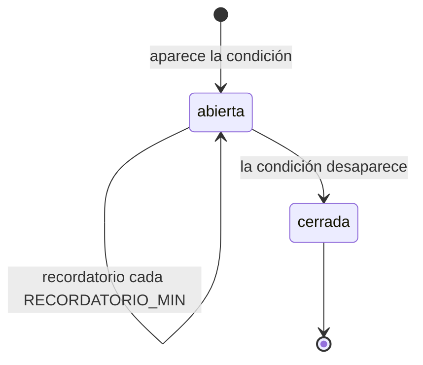

| Tipo de alerta | Cuándo |
|---|---|
| `nivel` | Fuera de rango (alta) o crítico (crítica) |
| `cambio_rapido` | Cambio de 0.5 de pH en 5 min aunque siga en rango (no manda recordatorios) |
| `sensor` | La lectura no es confiable |
| `sin_conexion` | El nodo dejó de enviar datos |

**Bandeja de avisos (outbox).** Los avisos no salen directo: se escriben en la colección `avisos` en la misma operación lógica que la alerta, y un enviador independiente los entrega.

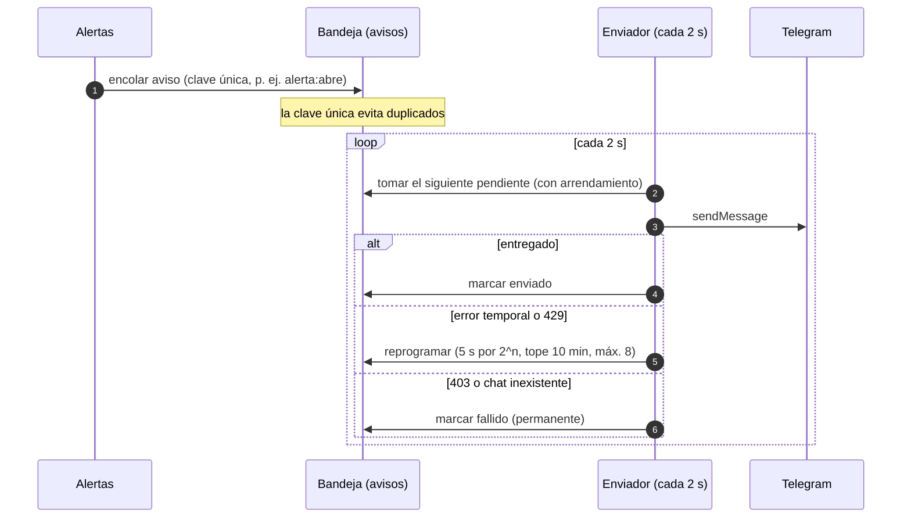

Garantía **al menos una vez**: un fallo justo después de enviar puede duplicar un aviso. Los textos nunca dicen «potable» ni «seguro» (lo verifica una prueba automática) y siguen el patrón *qué pasó + qué significa + qué hacer*.

### 7.4 Vinculación con Telegram

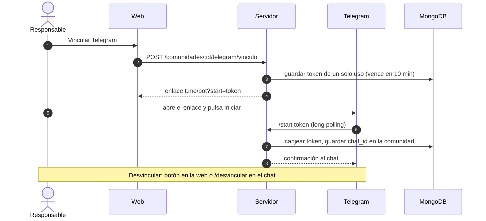

Una comunidad corresponde a un chat (puede ser un grupo), de modo que el aviso llega a todas las familias.

### 7.5 Control del actuador

Regla: **la nube nunca sube la dosis sola.** Pedir un pulso no manda nada a Blynk; una persona responsable debe confirmarlo.

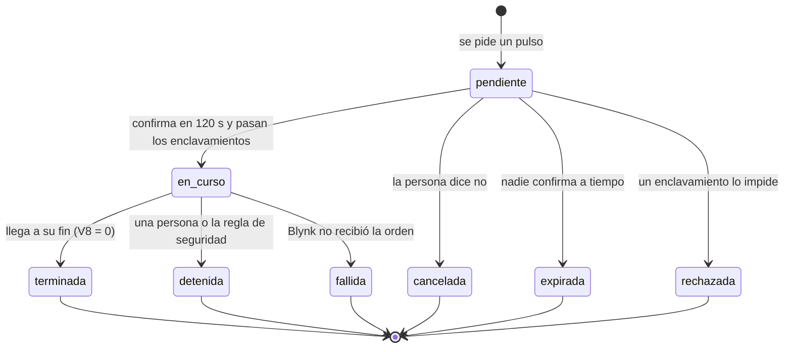

**Enclavamientos en la nube** (además de los del firmware, que son los que mandan): hay datos recientes, el sensor está sano, el pH está en rango (ni fuera de rango ni crítico), no hay otro pulso en curso, pasó el enfriamiento y la duración no supera el máximo del nodo (tope de 120 s del servidor).

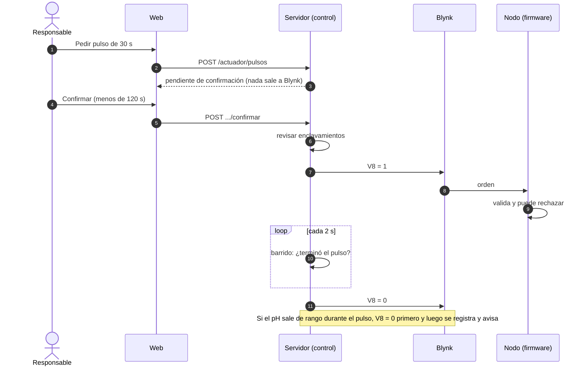

**Honestidad:** Blynk guarda el último valor escrito, no confirma que el relevador actuó. Los textos dicen «orden enviada» y «Atl no ve si actuó». Un actuador marcado `simulado` rotula todo como ensayo.

### 7.6 Calibración reportada por el nodo

Si el nodo publica `cal_pct` (V10, la pendiente de la sonda como % de Nernst), la ingesta lo convierte en calibración automática.

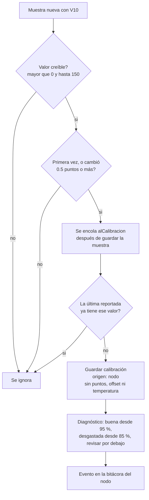

Una calibración registrada por una persona (con dos buffers) tiene `origen: "usuario"` y sí lleva puntos, offset y temperatura. No se abren alertas ni se manda Telegram por una sonda desgastada; queda en el historial y en el reporte.

### 7.7 Reportes PDF

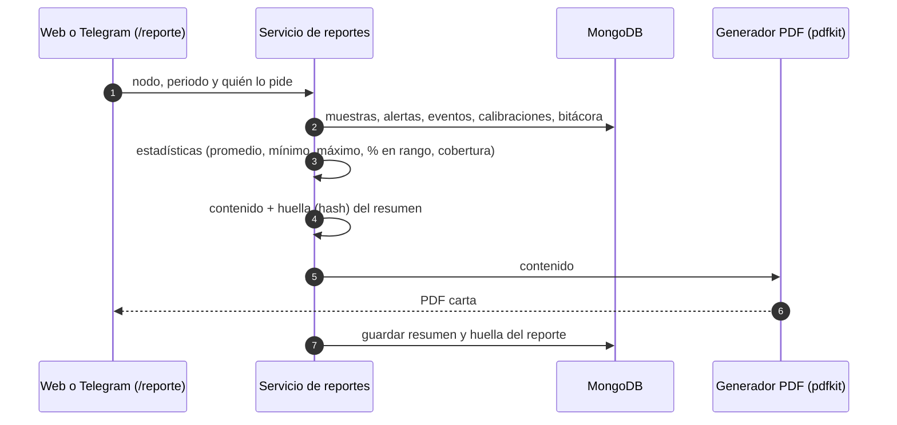

El PDF incluye: resumen en lenguaje sencillo, insignia «pH dentro del rango de la NOM-127 el X % del tiempo» (nunca un «CUMPLE» global), tabla de estadísticas con **cobertura de datos**, gráfica con la franja de la norma, eventos y alertas, calibraciones (rotuladas «(del nodo)» si las reportó la placa), bitácora y **lo que el reporte no cubre**.

### 7.8 Acceso e identidad

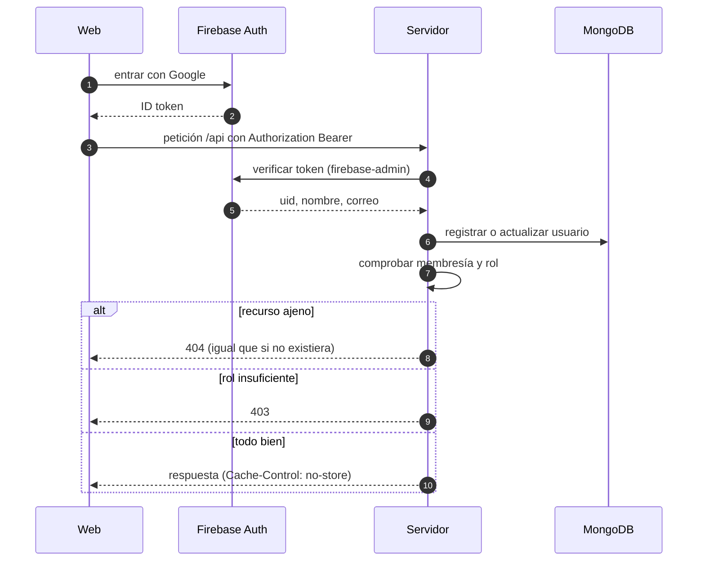

**Plan B de la demo:** un usuario de demostración fijo (`APP_ENV=demo` + `USUARIO_DEMO_ACTIVO=true` + un secreto compartido con la web), para que un fallo de Google no frene la presentación.

---

## 8. Modelo de datos (MongoDB)

Base `atl`. Fechas en UTC (`Date`); `America/Mexico_City` solo al mostrar y al agrupar por día. Los esquemas son flexibles (`v: { ph: 7.1 }`), sin migraciones.

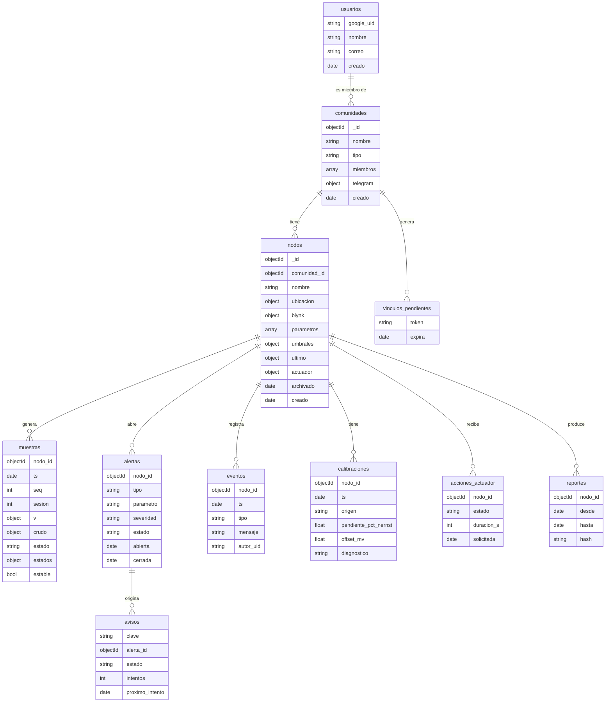

Notas de modelo:

- **`nodos.ultimo`** es la última «foto» (valor, estado, `seq`, `cal_pct`) para que la web y los avisos no tengan que leer las muestras.
- **Índices únicos** que sostienen las garantías: muestra por (nodo, sesión, `seq`); **una alerta abierta** por (nodo, tipo, parámetro); aviso por clave; **una acción viva** por nodo; un token de vinculación por valor (con vencimiento).
- **Borrado lógico:** quitar un nodo pone `archivado`; no se borra el historial. Un nodo archivado deja de sondearse, de verse en la API y de avisar; se puede **restaurar**.
- **Cifrado:** el token de Blynk se guarda con **AES-256-GCM** y jamás sale por la API ni a los logs.

---

## 9. API REST

Todas las rutas viven bajo `/api` y exigen `Authorization: Bearer <token de Firebase>`, salvo `GET /api/salud` (pública: `{ ok, mongo, blynk }`).

| Método y ruta | Rol mínimo | Qué hace |
|---|---|---|
| `GET /yo` | — | Usuario y sus comunidades |
| `POST /comunidades` | — | Crea una comunidad (quien la crea es responsable) |
| `GET /comunidades/:id/nodos` | integrante | Lista de nodos activos |
| `POST /comunidades/:id/nodos` | responsable | Alta: valida el token de Blynk, lo cifra y guarda el mapeo |
| `GET /comunidades/:id/nodos-quitados` | responsable | Nodos archivados |
| `POST /comunidades/:id/telegram/vinculo` | responsable | Enlace de vinculación de un solo uso |
| `DELETE /comunidades/:id/telegram` | responsable | Desvincula el chat |
| `GET /nodos/:id` | integrante | Estado, último valor y conexión |
| `PUT /nodos/:id` | responsable | Edita nombre y lugar |
| `DELETE /nodos/:id` | responsable | Quita el nodo (archiva) |
| `POST /nodos/:id/restaurar` | responsable | Restaura un nodo quitado |
| `GET /nodos/:id/muestras` | integrante | Serie agregada para la gráfica |
| `GET /nodos/:id/eventos` | integrante | Alertas, eventos y bitácora |
| `POST /nodos/:id/bitacora` | integrante | Nota humana |
| `GET`/`POST /nodos/:id/calibraciones` | integrante / responsable | Lista y registro de calibraciones |
| `GET`/`POST /nodos/:id/reportes` | integrante | Reportes anteriores / genera un PDF |
| `GET`/`PUT /nodos/:id/actuador` | responsable | Estado y ajustes del actuador |
| `POST /nodos/:id/actuador/pulsos` | responsable | Pide un pulso (no manda nada) |
| `POST .../pulsos/:accionId/confirmar` y `/cancelar` | responsable | Confirma o cancela |
| `POST /nodos/:id/actuador/detener` | responsable | Detiene un pulso en curso |

Convenciones: **un recurso ajeno responde 404, no 403**, para no revelar qué existe; un id mal formado también es 404; los errores de validación son 400; los de dominio, clases tipadas traducidas (409 conflicto, 422 token de Blynk inválido, 503 Blynk no responde); toda respuesta lleva `Cache-Control: no-store`. Una prueba verifica que **cada ruta con identificador** tenga su prueba de acceso cruzado.

---

## 10. Web (SPA)

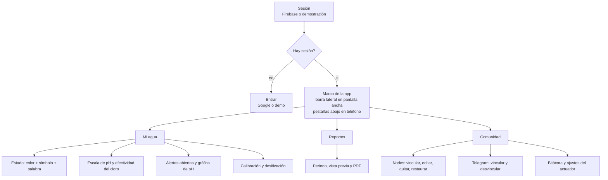

- **Estado de la UI:** consultas con un `useConsulta` propio (refresco automático, reintento), sin librerías de datos ni de rutas.
- **Cliente de la API tipado y validado:** cada respuesta se valida con zod; un 204 se acepta sin cuerpo; un POST/DELETE sin cuerpo no manda `content-type`.
- **Gráfica:** MUI X Charts con la línea del promedio, mínimo y máximo, y la franja de la norma; la línea se **corta en los huecos**.
- **Reglas de diseño que no se negocian:** solo tokens de `design/tokens.css`; el estado nunca va solo en color (símbolo y palabra); contraste AA; objetivos táctiles de 44 px; claro y oscuro; móvil primero; sin CDN.
- **Honestidad en los textos:** ninguno dice «potable», «seguro» ni «cumple NOM-127»; lo que Atl no mide se dice.

---

## 11. Seguridad y privacidad

| Tema | Cómo se resuelve |
|---|---|
| Identidad | Firebase Auth; el servidor solo verifica el ID token |
| Autorización | Rol por comunidad (`responsable` / `integrante`); recurso ajeno → 404 |
| Secretos | Solo en `.env` (no versionado); `.env.example` documenta los nombres; nunca se leen ni se piden valores |
| Token de Blynk | Cifrado AES-256-GCM; no sale en la API ni en logs |
| Entradas | zod `.strict()` en cuerpos, parámetros, entorno y catálogo |
| Datos personales | Logs con `redact`; ids en lugar de correos |
| Navegador | CORS limitado a `CORS_ORIGINS`; respuestas `no-store` |
| Actuador | Enclavamientos en el firmware **y** en la nube; confirmación humana obligatoria; nunca sube la dosis solo |
| Demo | `USUARIO_DEMO_TOKEN` queda dentro del JavaScript de la web: quien abra la web puede leerlo (solo plan B) |

---

## 12. Resiliencia: qué pasa cuando algo falla

| Falla | Comportamiento |
|---|---|
| Se cae el WiFi del nodo | La alarma local sigue; Atl abre «sin conexión» y el reporte muestra el **hueco** y la cobertura, sin inventar lecturas |
| Se cae Blynk | El poller reintenta con espera exponencial por nodo; se registra y no se inventan datos |
| Se cae Mongo | `/api/salud` lo dice; las escrituras esperan en memoria (hasta 200 por nodo) y se aplican en orden al volver |
| Se cae Telegram | Los avisos esperan en la bandeja y se reintentan; la web sigue mostrando la alerta |
| Sensor desconectado | `revisar_sensor`; el pulso del actuador se apaga; no se calcula con ese dato |
| Google no entra | Usuario de demostración |
| El servidor se reinicia | Retoma desde `nodos.ultimo`: no duplica muestras ni calibraciones |
| Un nodo comparte dispositivo de Blynk con otro | Se detecta y se advierte: los dos reaccionan a los mismos pines |

---

## 13. Configuración (nombres de las variables)

Validadas con zod al arrancar; si falta una requerida, el proceso no inicia. Los **valores** nunca se documentan ni se versionan.

| Grupo | Variables |
|---|---|
| Servidor | `PORT`, `APP_ENV` (`local` o `demo`), `CORS_ORIGINS` |
| Mongo | `MONGODB_URI`, `MONGODB_DB`, `MONGODB_DNS` |
| Blynk | `BLYNK_HOST`, `POLL_MS` (5000), `SIN_DATOS_S` (60), `INGESTA_ACTIVA`, `ACTUADOR_ESCRIBE_BLYNK` |
| Alertas | `RECORDATORIO_MIN` (30), `BARRIDO_MS` (15000) |
| Telegram | `TELEGRAM_BOT_TOKEN`, `TELEGRAM_BOT_USERNAME` |
| Identidad | `FIREBASE_PROJECT_ID`, `FIREBASE_USE_EMULATOR`, `USUARIO_DEMO_ACTIVO`, `USUARIO_DEMO_TOKEN` |
| Cifrado | `ATL_CLAVE_CIFRADO` |
| Web | `VITE_API_URL`, `VITE_FIREBASE_*`, `VITE_DEMO_TOKEN` |

---

## 14. Pruebas y calidad

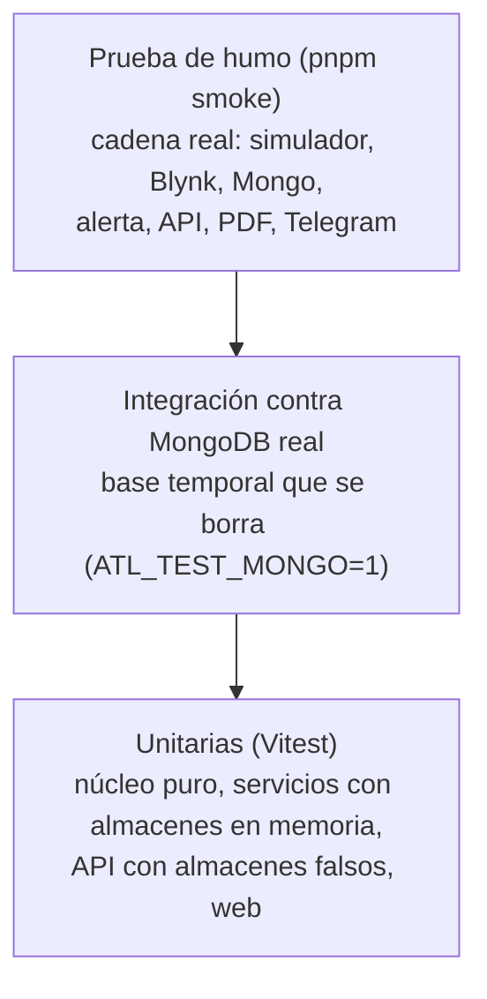

| Nivel | Cantidad actual | Qué cubre |
|---|---|---|
| Unitarias del servidor | 626 (más 26 de integración que se omiten sin Mongo) | Evaluación, dominio, ciclo de ingesta, alertas, control, reportes, API con acceso cruzado, frases sin «potable» |
| Unitarias de la web | 78 | Cliente de la API, cálculo de la gráfica, estados, rutas, configuración |
| Integración | Opcional (`ATL_TEST_MONGO=1`) | Índices, transiciones atómicas, archivado, calibraciones |
| Humo | Manual | Recorrido de la cadena completa con datos propios, que se borran al terminar |

Siempre en verde antes de dar un paso por terminado: `lint` (Biome), `typecheck` (TypeScript estricto), pruebas y, en la web, `build`.

---

## 15. Decisiones de diseño y sus razones

| Decisión | Razón | Costo aceptado |
|---|---|---|
| Blynk **y** una base propia | Blynk es excelente en vivo, pero su histórico gratuito es corto y no guarda calibraciones, acciones ni bitácora | Dos fuentes que mantener coherentes |
| Sondeo (polling) en vez de webhooks | No requiere URL pública (no hay VPS); es simple y robusto | La marca de tiempo es la del sondeo, no la de la medición |
| MongoDB | Esquema flexible (los parámetros pueden cambiar el día del reto), sin migraciones | Necesita internet; plan B con Mongo local |
| Un solo proceso con bucles | Para un hackathon sobran colas y brokers | Escalar exigiría separar procesos |
| Bandeja de avisos en la base | Garantiza entrega al menos una vez con reintentos, sin infraestructura extra | Posible aviso duplicado ante un fallo justo al enviar |
| Reconciliación de alertas | Idempotente: reintentar no repite nada | Más lógica que «un evento, una alerta» |
| Borrado lógico de nodos | Conserva el historial para los reportes | Los archivados quedan en la base |
| Confirmación humana del actuador | Seguridad: la nube no decide dosificar | Un paso más para el usuario |
| Calibración reportada, no calculada | El nodo ya calcula su pendiente; Atl solo la registra | Sin puntos ni offset |

---

## 16. Limitaciones y lo que no está verificado

Declarado con la misma honestidad que el producto:

- **Hardware y firmware:** el firmware está bosquejado y *compila*, pero no se ha probado en placa. Lo que se probó de punta a punta fue con el **simulador**.
- **Blynk real:** no se verificaron los límites de tasa ni del plan gratuito con sondeo sostenido; no se confirmó que el dispositivo real publique V10.
- **Google y Firebase reales:** el acceso con Google real y teléfonos reales no se probaron; sí con la cuenta de demostración.
- **Cámara y QR:** no existen en esta versión.
- **Telegram:** probado con el bot real por long polling; grupos de Telegram y el webhook no se probaron; la confirmación del actuador por botón de Telegram **no se construyó**.
- **Despliegue:** todo corre en local; la validación contra un servidor real queda para una etapa posterior.
- **Escalado:** probado con uno o pocos nodos; no con muchos a la vez ni durante horas.
- **Actuador:** sin relevador real; Atl no ve si el relevador actuó.
- **Umbrales:** 0.3 / 0.5 / 1.0 / 85 % son criterio del equipo, no de la norma, y no los ha validado un especialista.
- **Gráfica con datos reales con huecos:** probada con datos sembrados sin huecos.

---

## 17. Fuentes de los nombres de la arquitectura

- [The Hexagonal or Ports & Adapters Architecture (keynote de Alistair Cockburn, SAG 2025)](https://conferences.isaqb.org/software-architecture-gathering/sag-2025-keynote-alistair-cockburn-the-hexagonal-or-ports-adapters-architecture/): el artículo original de 2005 está en alistair.cockburn.us/hexagonal-architecture
- [Ports & Adapters Architecture (Herberto Graça)](https://herbertograca.com/2017/09/14/ports-adapters-architecture/)
- [Pattern: Transactional outbox (microservices.io)](https://microservices.io/patterns/data/transactional-outbox) y [Pattern: Polling publisher](https://microservices.io/patterns/data/polling-publisher.html)
- [Functional Core, Imperative Shell (resumen de la charla *Boundaries* de Gary Bernhardt, 2012)](https://kyle.au/notes/technology/development/functional-core-imperative-shell-pattern)
