# Metodología de desarrollo de Lympha Atl

## Spec-Driven Development (SDD), nivel *spec-anchored*

> Este documento describe **cómo se construyó** Lympha Atl: el método de trabajo, sus reglas, sus artefactos y la evidencia de que se siguió. La arquitectura resultante está en [`ARQUITECTURA_LYMPHA_ATL.md`](./ARQUITECTURA_LYMPHA_ATL.md).
>
> **Sobre el nombre.** El método se llama **Spec-Driven Development (SDD)**, un término real y vigente (ver las [fuentes](#18-fuentes)). Las fuentes lo describen como una **práctica emergente sin una definición única ni un estándar formal**; casi toda la bibliografía son guías de empresas y herramientas de 2025–2026. En una frase: una **especificación escrita, y no el código, es la fuente de verdad**, y el código se construye y se valida contra ella.
> En una versión anterior de este documento se usó otro nombre («DIGEE»); era una etiqueta inventada y se **retiró** para no presentar como estándar algo que no lo es.
> Lo que sigue se describe **a posteriori**, a partir de lo que está en el repositorio (documentos, reglas, commits, registro de decisiones y pruebas).

---

## 1. SDD en una frase y cómo encaja el proyecto

> **Se escribe primero lo que se va a construir, se construye en pasos pequeños que ya funcionan de punta a punta, y ningún paso se da por terminado sin evidencia de que funciona (y sin decir con la misma franqueza lo que no se pudo comprobar).**

### 1.1 Los tres niveles de SDD y dónde está este proyecto

Jama Software distingue tres niveles de compromiso con la especificación:

| Nivel | Idea | ¿Lympha Atl? |
|---|---|---|
| **Spec-first** | Se escribe la especificación antes del código | Sí: `ARQUITECTURA.md`, `PLAN_HACKATON.md` e `IDENTIDAD_VISUAL.md` existieron antes de la primera línea de servidor |
| **Spec-anchored** | La especificación se mantiene viva después de implementar | **Sí, este es el nivel del proyecto**: se actualizaron `decisiones.md`, `CLAUDE.md`, el contrato del firmware y, al final, la arquitectura «tal como quedó» |
| **Spec-as-source** | La especificación es el archivo principal y el código se deriva de ella | No: el código sigue siendo el artefacto que se edita a mano |

Por eso se dice *spec-anchored*: la especificación no se abandona al empezar a programar; se mantiene en sincronía con el código.

### 1.2 Las fases de SDD y su equivalente aquí

Las fuentes describen el flujo como **especificar → implementar contra la especificación → validar**.

| Fase de SDD | En Lympha Atl |
|---|---|
| **Especificar** | Fase 0 de verificación + `ARQUITECTURA.md`, plan, identidad visual, reglas no negociables y la jerarquía de fuentes |
| **Implementar contra la especificación** | Pasos verticales (sección 8), cada uno con su bucle (sección 5) |
| **Validar** | Compuertas de calidad (sección 6): tipos, lint, pruebas, integración, verificación real y reporte honesto |

### 1.3 Qué lo distingue de TDD, BDD y de «vibe coding»

- **TDD y BDD** comparten raíces con SDD (todos exigen decir antes qué debe pasar), pero el artefacto canónico de TDD son las pruebas y el de BDD, los escenarios de comportamiento; en SDD es la **especificación**. Aquí se usan las tres cosas: la especificación manda y las pruebas la verifican.
- **Vibe coding** acepta lo que produzca un modelo a partir de un mensaje. Las fuentes lo consideran razonable para prototipos desechables y a SDD para código de producción y proyectos de varios meses. Lympha Atl se desarrolló con un agente de IA, pero **dentro** de la especificación, no en su lugar.

### 1.4 Lo que se agregó encima de SDD

Estas prácticas **no son parte de la definición de SDD**; son las que este proyecto añadió por sus restricciones:

| Práctica añadida | Motivo |
|---|---|
| **Fase 0 de verificación** (sin código de producto) | Servicios y hardware con límites desconocidos |
| **Simulador y prueba de humo** | Hardware no disponible durante el desarrollo |
| **Compuertas de evidencia y registro de lo «no probado»** | Producto sobre agua: no se puede afirmar sin comprobar |
| **Diseño dirigido por configuración** | El reto (y el sensor) se revelan el día del evento |
| **Planes B por riesgo** | Plazo muy corto |

---

## 2. Por qué este método: el contexto que lo exigió

El proyecto nació con restricciones que hacen costoso equivocarse tarde:

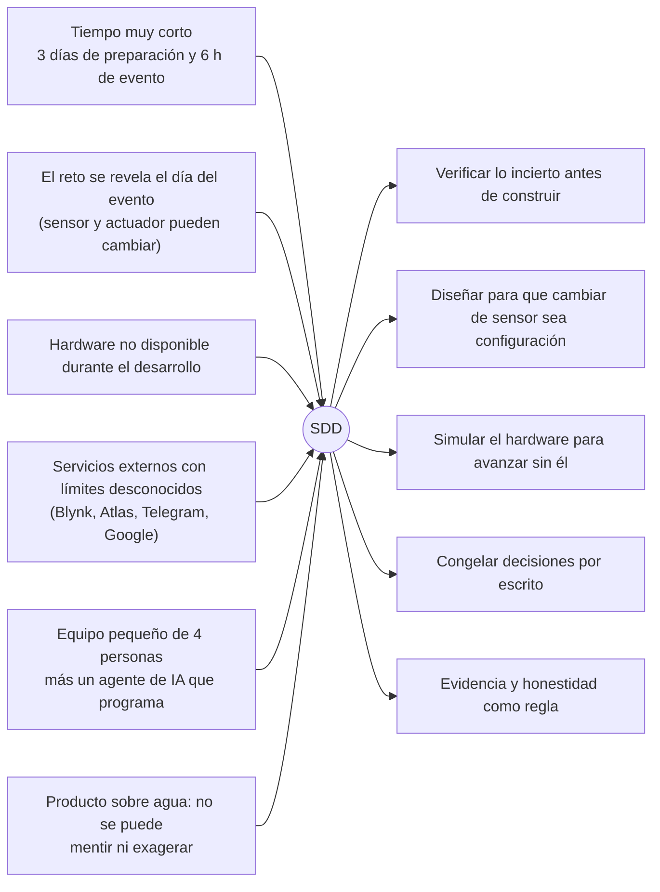

Cada práctica que se añadió a SDD responde a una de estas presiones; ninguna se adoptó por moda.

---

## 3. Principios

| # | Principio | Cómo se aplica en Lympha Atl |
|---|---|---|
| 1 | **Verificar lo incierto antes de construir** | El *Paso 0* es solo verificación (sin código): se comprobaron con `curl` la API de Blynk y la conexión a Atlas, y se anotó la forma real de las respuestas. «No avances si esto falla.» |
| 2 | **La especificación manda, y tiene jerarquía** | Si dos documentos se contradicen: **datos verificados > arquitectura > plan > identidad visual**. Las contradicciones que cambian el diseño se preguntan; las menores se deciden y se anotan. |
| 3 | **Pasos verticales ordenados por dependencia** | Cada paso entrega algo que corre de punta a punta con lo anterior (ver sección 8). No hay una capa «terminada» sin que nada la use. |
| 4 | **Núcleo puro, bordes delgados** | La lógica que decide (evaluación, ciclo de ingesta, reglas de alertas y del actuador, dominio de pH) es pura y se prueba sin red ni base de datos; el I/O vive en adaptadores. |
| 5 | **Dirigido por configuración** | Parámetros, límites, reglas y pines son datos (`parametros.json`). Cambiar de sensor no debe tocar la lógica. |
| 6 | **Simulador primero** | Un simulador de nodo escribe en Blynk como lo haría la placa; permite probar toda la cadena sin hardware y es el plan B de la demo. |
| 7 | **Evidencia antes que afirmación** | Cada paso cierra con lint, tipos y pruebas en verde, más una verificación real o visual cuando es posible. Lo que no se pudo verificar se escribe como «sin verificar». |
| 8 | **Decisiones por escrito, con su razón** | Un registro de decisiones (`decisiones.md`) guarda qué se decidió, por qué y qué costo se aceptó; un archivo de memoria (`CLAUDE.md`) guarda las reglas y el estado. |
| 9 | **Honestidad del producto como requisito** | Nunca «potable» ni «seguro»; el reporte dice lo que no mide; los huecos se registran y no se rellenan. Una prueba automática lo vigila. |
| 10 | **Seguridad por defecto** | Los secretos nunca se leen ni se piden; el actuador no actúa sin confirmación humana; los recursos ajenos responden 404. |
| 11 | **Plan B para cada riesgo** | Para cada punto de falla del evento existe una alternativa probada (sección 12). Regla: *si algo no funciona 30 minutos, se corta y se usa el plan B*. |
| 12 | **Cambios pequeños, reversibles y a la vista** | Se listan los archivos antes de tocarlos; no se hace commit ni push sin que el dueño lo pida; las acciones destructivas se confirman. |

---

## 4. El ciclo de vida

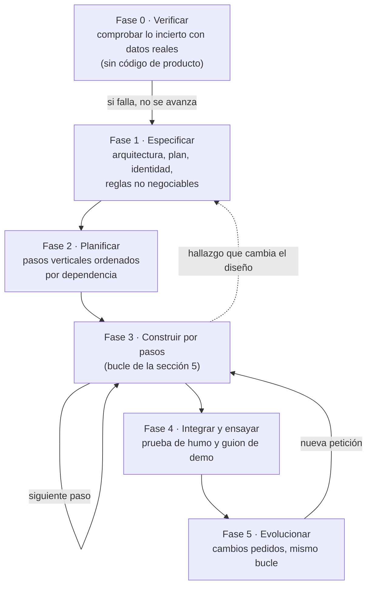

Observaciones:

- **El diseño no se congela para siempre**, pero **solo se cambia a propósito**: un hallazgo que altera el diseño regresa a la especificación (flecha punteada) y se pregunta, no se resuelve en silencio dentro del código.
- **La Fase 5 usa el mismo bucle.** Por ejemplo, quitar y restaurar nodos, editar su nombre, la gráfica con MUI X Charts y la calibración reportada por el nodo se trabajaron cada una como un paso completo (diseño breve, implementación, pruebas, verificación, registro).

---

## 5. El bucle de cada paso

Es el corazón del método. Todo paso, grande o pequeño, recorre estas etapas.

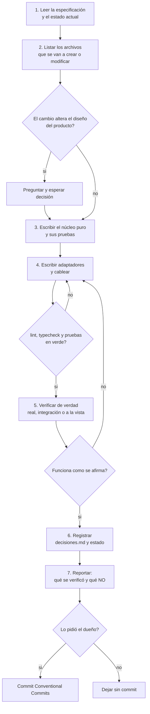

Detalle de las etapas:

1. **Leer** la especificación y el estado para no re-derivar lo ya decidido.
2. **Listar los archivos** que se tocarán *antes* de tocarlos. Es una compuerta de transparencia y de alcance.
3. **Núcleo puro primero**, con pruebas: así la lógica se valida sin depender de servicios externos.
4. **Adaptadores y cableado** después: Mongo, Blynk, Telegram, HTTP.
5. **Verificar de verdad.** Según el caso: contra el servicio real, una prueba de integración con una base temporal que se borra, o a la vista en el navegador (escritorio y móvil, claro y oscuro, con varios estados). Los datos de prueba se crean para el paso y **se borran al terminar**.
6. **Registrar** la decisión y el estado: qué quedó hecho, qué se verificó y qué sigue sin verificar.
7. **Reportar con franqueza.** El reporte final separa lo verificado de lo no probado; «compila» no se reporta como «funciona».

---

## 6. Compuertas de calidad (gates)

Un paso **no está terminado** hasta pasar todas:

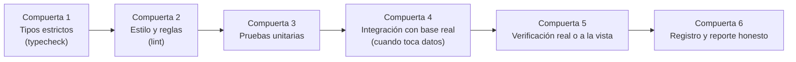

| Compuerta | Herramienta | Qué evita |
|---|---|---|
| Tipos | TypeScript estricto (`tsc --noEmit`) | Errores de contrato entre módulos |
| Lint | Biome | Estilo inconsistente y malas prácticas |
| Unitarias | Vitest | Regresiones en reglas de negocio |
| Integración | Vitest contra MongoDB real (`ATL_TEST_MONGO=1`, base temporal) | Que lo que funciona con almacenes en memoria falle con la base real |
| Verificación real | Servicio real, navegador, simulador, prueba de humo | Afirmar «funciona» sin haberlo visto |
| Registro | `decisiones.md`, estado en `CLAUDE.md` | Perder el porqué de las decisiones |

Compuertas **automáticas de honestidad** (se prueban, no se confía en la memoria):

- Ningún texto de aviso, web o reporte dice «potable» ni «seguro» (`dominio/frases`).
- No hay `if` por nombre de parámetro fuera de `dominio/ph.ts`.
- Cada ruta con identificador tiene su prueba de acceso cruzado (404 al ajeno, 403 al integrante sin permiso).
- Las configuraciones obligatorias se validan al arrancar: si falta una, el proceso no inicia.

---

## 7. Artefactos y su jerarquía

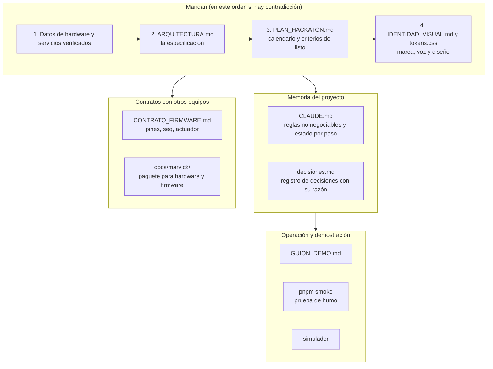

| Artefacto | Función en el método |
|---|---|
| `ARQUITECTURA.md` | Especificación de partida: qué se construye y por qué. Declara lo que depende de hardware o de terceros como «VERIFICAR». |
| `PLAN_HACKATON.md` | Calendario, roles, guion de la demo y **criterios de «listo»** como casillas verificables. |
| `IDENTIDAD_VISUAL.md` + `tokens.css` | Reglas de marca, voz y accesibilidad; una sola fuente de verdad de diseño. |
| `CLAUDE.md` | Memoria entre sesiones: reglas no negociables, orden de construcción, comandos y la **tabla de estado** (qué se hizo, qué se verificó, qué no). |
| `decisiones.md` | Bitácora de decisiones por paso, con razón y costo aceptado. |
| `CONTRATO_FIRMWARE.md` | El acuerdo entre servidor y placa; permite trabajar en paralelo sin integrarse todavía. |
| `GUION_DEMO.md` | Separa lo que Atl hace hoy (probado) de lo que depende del hardware («solo si»). |
| `ARQUITECTURA_LYMPHA_ATL.md` | La arquitectura *tal como quedó construida* (este conjunto de documentos). |

**Regla de oro de los documentos:** si el código y un documento no coinciden, se corrige el documento o se pregunta; nunca se deja la contradicción. Ejemplo real: la fórmula de efectividad del cloro dio ≈ 15 % para pH 8.3 y no el «~24 %» que traía un ejemplo del documento de identidad; se corrigió y se anotó.

---

## 8. Orden de construcción: pasos verticales por dependencia

El plan se ordenó para que **cada paso dependiera solo de los anteriores** y dejara algo ejecutable. Los pasos 0 a 8 se podían hacer **sin hardware** gracias al simulador.

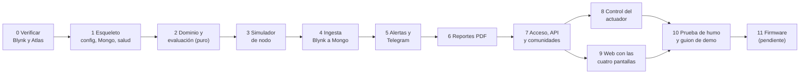

Por qué este orden:

- **Lo puro antes que lo conectado** (pasos 1 y 2): la evaluación del agua se valida con pruebas antes de existir cualquier red.
- **El simulador antes de la ingesta** (paso 3): así la ingesta se prueba contra algo que se comporta como la placa.
- **Los avisos antes de la API** (5 y 6): el valor del producto (avisar y documentar) existe antes que su interfaz.
- **La web al final de lo funcional** (9): se construye sobre una API estable.
- **El firmware, al final y marcado «compila»** (11): nunca se afirma «funciona» sin hardware.

### Cronograma real

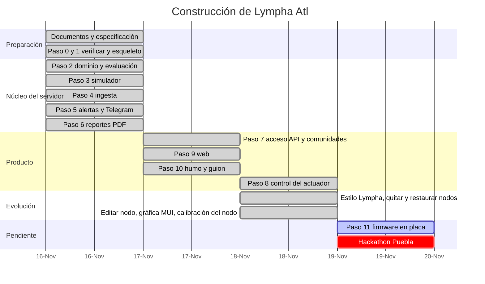

---

## 9. Estrategias técnicas que sostienen el método

### 9.1 Núcleo funcional, bordes imperativos

Las decisiones (¿hay muestra nueva?, ¿en qué estado está el agua?, ¿qué alertas deben existir?, ¿se puede dar este pulso?) son **funciones puras** que reciben datos y devuelven datos. Los bordes (Blynk, Mongo, Telegram) se inyectan por **puertos** (interfaces). Consecuencias:

- Se prueban miles de casos en milisegundos y sin red.
- Los adaptadores se reemplazan (otra base, otra plataforma) sin tocar la lógica.
- Un fallo externo no corrompe una decisión: se reintenta con la misma entrada.

### 9.2 Idempotencia y reconciliación

En lugar de reaccionar a **eventos** (que pueden repetirse o perderse), el sistema compara **estado deseado contra estado actual** y corrige la diferencia. Así reintentar, reiniciar o duplicar una ejecución no repite avisos ni registros. Se apoya en índices únicos (una alerta abierta por tipo y parámetro, una acción viva por nodo, un aviso por clave).

### 9.3 Dirigido por configuración

Lo que probablemente cambie el día del evento (sensor, rangos, pines) es **dato**, validado con zod al arrancar. La tabla de adaptación de la arquitectura convierte cada posible sorpresa del reto en una acción acotada.

### 9.4 Simulador y prueba de humo

- El **simulador** reproduce escenarios (estable, acidificación, pico, sensor desconectado, nodo detenido, un caso de demo con limón) escribiendo en Blynk como la placa.
- La **prueba de humo** recorre la cadena real (simulador → Blynk → ingesta → Mongo → alerta → API → PDF → Telegram opcional) con datos propios que luego borra, y avisa cuándo gasta llamadas de un servicio con tope.

### 9.5 Honestidad como diseño

Cuatro mecanismos concretos: la **cobertura de datos** en el reporte; el **registro del hueco** en lugar de interpolar; el estado **«revisar sensor»** en vez de un número dudoso; y los textos de **«orden enviada»** (no «dosificado») cuando Atl no puede ver si el relevador actuó.

### 9.6 Seguridad como regla, no como tarea final

Secretos fuera del código y del alcance del agente; cifrado del token de Blynk; verificación de identidad en cada ruta; 404 uniforme para lo ajeno; confirmación humana para lo físico. Se decidieron en la especificación y se vigilan con pruebas.

### 9.7 La arquitectura que resultó, con su nombre

La especificación (SDD) pidió fronteras claras, un núcleo que se pueda probar sin red y bordes intercambiables. Con nombres **establecidos** (no inventados), eso es:

> **Un monolito modular con arquitectura hexagonal (puertos y adaptadores).**

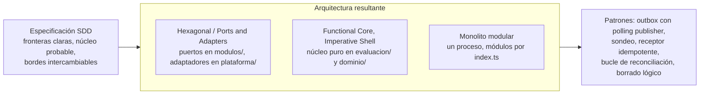

| Nombre | Qué es | Dónde se ve en Atl |
|---|---|---|
| **Arquitectura hexagonal / Ports & Adapters** (Alistair Cockburn, 2005) | La lógica queda en el centro; las interfaces (puertos) están dentro de la aplicación y las implementaciones técnicas (adaptadores) fuera, con puertos de entrada (*driving*) y de salida (*driven*) | `modulos/` define los puertos (`LectorNodo`, `AlmacenIngesta`…); `plataforma/` trae los adaptadores (Blynk, Mongo, Telegram, Firebase, PDF) |
| **Monolito modular** (estilo de despliegue) | Una sola unidad desplegable con módulos de fronteras claras | Un proceso Node; cada módulo expone solo su `index.ts` |
| **Functional Core, Imperative Shell** (Gary Bernhardt, 2012) | Núcleo de funciones puras y una capa exterior para los efectos | `evaluacion/`, `dominio/`, `decidirCiclo`, reglas de alertas y del actuador |

Patrones que lo acompañan: **outbox con *polling publisher*** (la bandeja de avisos; *matiz:* aquí no hay una transacción multidocumento, la unicidad la da una clave única), **sondeo**, **receptor idempotente**, **bucle de reconciliación** (comparar estado deseado contra actual) y **borrado lógico**.
Lo que **no** es: microservicios, *event sourcing*/CQRS ni una arquitectura en capas clásica. El detalle completo está en [`ARQUITECTURA_LYMPHA_ATL.md`](./ARQUITECTURA_LYMPHA_ATL.md#11-cómo-se-llama-esta-arquitectura).

---

## 10. Estrategia de pruebas y de evidencia

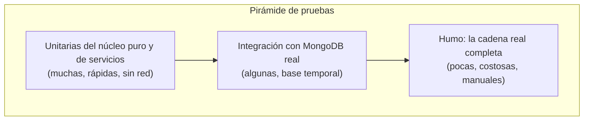

| Nivel | Cantidad actual | Se ejecuta |
|---|---|---|
| Unitarias del servidor | 626 | Siempre (`pnpm test`) |
| Unitarias de la web | 78 | Siempre |
| Integración con MongoDB | 26 casos (se omiten sin Mongo) | Bajo demanda con `ATL_TEST_MONGO=1` |
| Humo | Cadena completa | Manual, avisando si gasta cuota de Blynk |
| A la vista | Escritorio y móvil, claro y oscuro, seis estados del agua | En cada cambio visual |

**El registro de lo no probado** es parte de la evidencia. La tabla de estado del proyecto tiene, por paso, tres columnas implícitas: *qué quedó hecho*, *qué se verificó de verdad* y *qué sigue sin verificar*. Ejemplos reales de ese registro: «el firmware compila, no se probó en placa», «el acceso con Google real no se probó», «sin relevador real», «la gráfica no se vio con datos con huecos reales».

---

## 11. Control de versiones y cambios

| Regla | Detalle |
|---|---|
| Rama | Todo el trabajo en la rama `hackathon/atl`, nunca directo a `main`. |
| Commits | *Conventional Commits* con un commit por paso, por ejemplo `feat(hackathon): paso 8 de Atl (control del actuador con confirmación)`. |
| Cuándo se hace commit | **Solo cuando el dueño lo pide.** Nunca push sin pedirlo. |
| Dependencias | No se agregan fuera del stack aprobado sin preguntar (ejemplo: la gráfica con MUI X Charts se instaló por petición explícita y quedó anotada en `CLAUDE.md`). |
| Alcance | No se modifica nada fuera de `hackathon/` salvo propuesta confirmada. |
| Cambios destructivos | Se confirman; se prefiere el borrado lógico (por eso «quitar nodo» archiva en vez de borrar). |
| Documentos | Se actualizan junto con el código (decisiones, contrato del firmware, estado). |

### Cómo entra un cambio pedido después

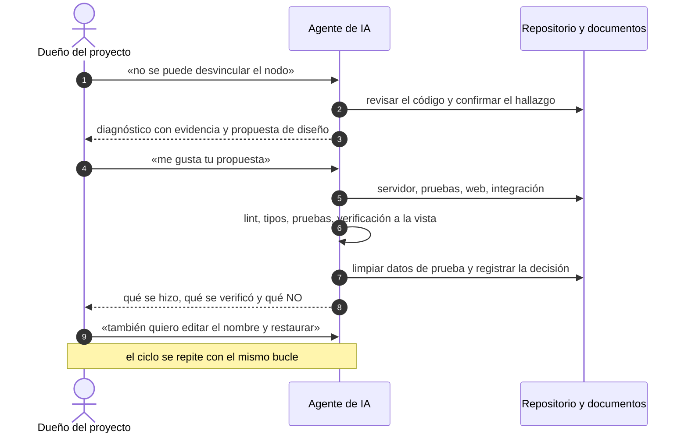

---

## 12. Gestión de riesgos y planes B

Para cada punto de falla identificado, existe una alternativa **preparada y probada**.

| Riesgo | Plan B | Señal para activarlo |
|---|---|---|
| No hay hardware o falla el sensor | Simulador de nodo con escenarios | El sensor no responde |
| Falla el acceso con Google | Usuario de demostración | Google rechaza el dominio o tarda |
| Atlas o el internet del recinto fallan | Mongo local en Docker (`MONGODB_URI`) | Atlas no resuelve (también se puede forzar DNS) |
| Telegram no responde | Los avisos esperan en la bandeja y se reintentan | Errores del bot |
| Blynk lento o con tope de mensajes | Modo ligero de la prueba de humo; ensayo sin escribir en Blynk | Respuestas lentas |
| La demo se complica | Video de respaldo y guion con partes «solo si» | Algo no funciona en 30 minutos: se corta |
| El reto cambia el sensor | Tabla de adaptación (una entrada en el catálogo) | Se revela el reto |

Regla transversal: **se prefiere degradar con honestidad a fallar en silencio.**

---

## 13. Colaboración entre personas y un agente de IA

El proyecto se desarrolló con un equipo humano y un agente de IA que escribe código. El método define **quién decide qué**:

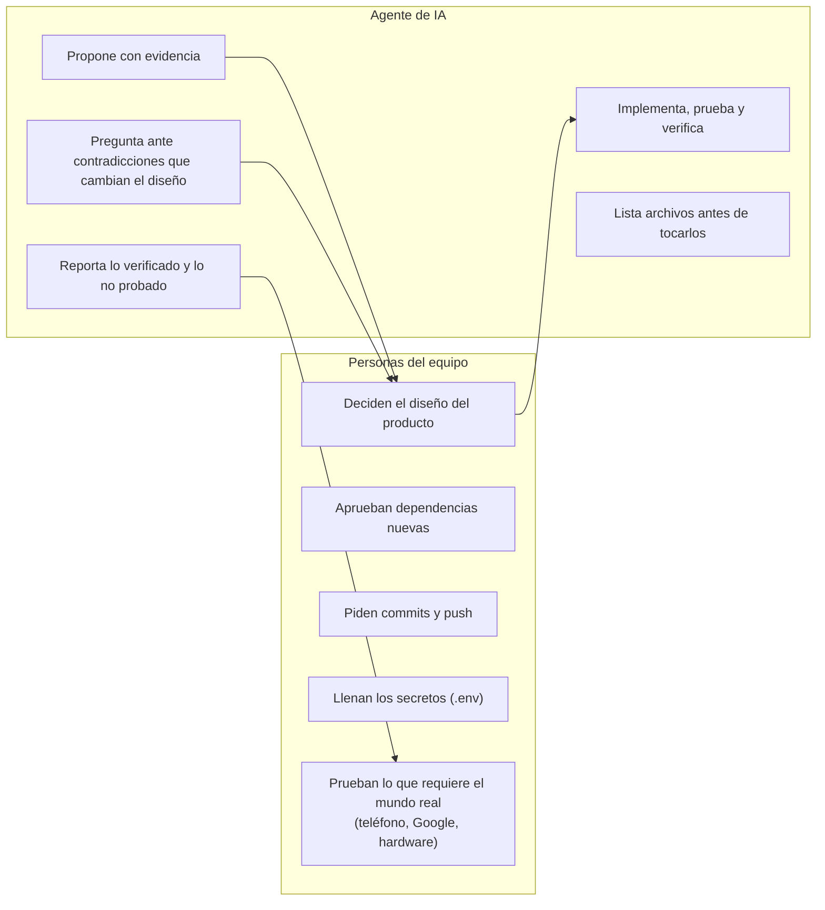

Reglas de la colaboración:

- **El agente propone y las personas deciden** lo que cambia el producto; lo que solo cambia el aspecto se hace y se reporta.
- **Nunca se leen ni se piden secretos**: las variables se documentan por nombre y la persona llena su `.env`.
- **Las acciones con efecto en el mundo real** (avisos por Telegram reales, escribir en un dispositivo de Blynk con alertas vinculadas) se **avisan antes**; para ver estados se prefieren datos de prueba propios y un modo demo sin red externa.
- **Los procesos que se levantan se detienen al terminar** y se verifica que no queden puertos ocupados.
- **El estado vive en documentos, no en la memoria de la conversación**, para que cualquiera (persona o agente) retome el trabajo.

---

## 14. Evidencia de que se siguió: resumen por paso

| Paso | Fecha | Resultado | Cómo se verificó |
|---|---|---|---|
| 0 | 16-nov | Blynk y Atlas verificados; plantilla creada | `curl` real a Blynk; ping, escritura y borrado en Atlas |
| 1 | 16-nov | Esqueleto, `/api/salud`, índices | Pruebas, lint, tipos; salud en `true` con el servidor real |
| 2 | 16-nov | Dominio de pH y evaluación | 68 pruebas unitarias sin red |
| 3 | 16-nov | Simulador y cliente de Blynk | Escritura y lectura de vuelta contra el dispositivo real |
| 4 | 16-nov | Ingesta Blynk a Mongo | Pruebas + integración con Atlas; de punta a punta con el simulador |
| 5 | 16-nov | Alertas y Telegram | Bot real: 6 avisos entregados (abre, escala, cierra) |
| 6 | 16-nov | Reportes PDF y `/reporte` | PDF revisado a la vista y recibido en Telegram |
| 7 | 17-nov | Acceso, API REST y comunidades | Pruebas de acceso cruzado; servidor, Atlas y Blynk reales |
| 9 | 17-nov | Web con cuatro pantallas | A la vista en escritorio y móvil, claro y oscuro |
| 10 | 17-nov | Prueba de humo y guion | Corrida real de 16 pasos; Telegram recibido por el dueño |
| 8 | 18-nov | Control del actuador | Pruebas, integración y flujo a la vista con pulso simulado |
| Evolución | 18-nov | Estilo Lympha, quitar y restaurar nodos, editar, gráfica MUI, calibración del nodo | Pruebas unitarias e integración; flujo a la vista con datos de prueba borrados |
| 11 | pendiente | Firmware en placa | Solo «compila»; falta probar en hardware |

---

## 15. Límites de la metodología

SDD, tal como se aplicó aquí, tiene costos, y conviene decirlos:

- **Exige disciplina documental.** Mantener especificación, decisiones y estado al día cuesta tiempo; en proyectos de horas puede sentirse pesado.
- **Depende de que la especificación sea buena.** Una especificación equivocada se implementa con mucho rigor; por eso existe la Fase 0 y la regla de preguntar ante contradicciones.
- **Verificar «de verdad» no siempre es posible** (hardware, cuentas de terceros, teléfonos reales). El método no lo resuelve: obliga a **declararlo**.
- **Se describió a posteriori.** El método fue emergiendo durante el trabajo; esta formalización es retrospectiva. No hay mediciones comparativas contra otro método, así que no se afirma que sea «mejor», solo que **es lo que se hizo y por qué**. Además, SDD es una práctica emergente sin estándar formal: lo que aquí se llama así sigue las descripciones de las fuentes, no una norma.
- **No sustituye la validación de dominio.** Los umbrales de pH son criterio del equipo; no los validó un especialista.

**Cuándo conviene:** proyectos con plazo corto, incertidumbre externa (hardware, APIs, reglas del evento), equipos pequeños y/o con un agente de IA, y productos donde decir algo falso tiene costo (salud, agua, finanzas).
**Cuándo no:** exploraciones desechables, prototipos de un solo uso o proyectos donde la especificación cambia por completo cada día.

---

## 16. Prácticas conocidas que acompañan a SDD en este proyecto

| Práctica | Aporte |
|---|---|
| Spec-Driven Development | Documento fuente con jerarquía y que se mantiene vivo |
| *Walking skeleton* / rebanadas verticales | Cada paso corre de punta a punta |
| Arquitectura hexagonal (puertos y adaptadores) | Núcleo puro y adaptadores intercambiables |
| *Functional core, imperative shell* | Decisiones puras, I/O en los bordes |
| Registro de decisiones de arquitectura (ADR) | `decisiones.md` con razón y costo |
| Pruebas en pirámide y compuertas de calidad | Unitarias, integración y humo |
| Desarrollo basado en el tronco y *Conventional Commits* | Rama única de trabajo y commits legibles |
| *Spikes* de verificación | Fase 0 sin código de producto |
| Gestión de riesgos con plan B | Alternativas probadas por punto de falla |
| *Definition of Done* verificable | Criterios de «listo» como casillas y compuertas |

---

## 17. Cómo repetirlo en otro proyecto (lista de arranque)

1. **Fase 0:** lista lo incierto (servicios, hardware, límites) y verifícalo con datos reales. No avances si falla.
2. **Escribe la especificación** y una **jerarquía de fuentes** (qué documento gana).
3. **Define reglas no negociables** (honestidad, seguridad, fronteras entre módulos) y automatiza las que se puedan (pruebas, linter, validación al arrancar).
4. **Divide en pasos verticales** ordenados por dependencia; pon lo puro antes que lo conectado y un **simulador** antes de lo que toque hardware.
5. **Para cada paso:** lista archivos → pregunta si cambia el diseño → núcleo puro con pruebas → adaptadores → compuertas → verificación real → registro → reporte con lo no probado.
6. **Lleva dos documentos vivos:** memoria con reglas y estado, y bitácora de decisiones.
7. **Prepara un plan B** para cada riesgo y una regla de corte por tiempo.
8. **Commits solo cuando el dueño lo pide**, con mensajes convencionales; nada destructivo sin confirmar.

---

## 18. Fuentes

SDD es un término en formación; estas fuentes sirvieron para describirlo y **no son una norma**:

- [What is Spec-Driven Development? (GitHub Spec Kit)](https://github.github.com/spec-kit/concepts/sdd.html)
- [What is spec-driven development (SDD) for AI-powered engineering (Jama Software)](https://www.jamasoftware.com/blog/what-is-spec-driven-development-sdd-for-ai-powered-engineering/): los tres niveles *spec-first*, *spec-anchored* y *spec-as-source*
- [Spec-Driven Development: Everything You Need to Know (Zencoder)](https://zencoder.ai/blog/spec-driven-development)
- [What Is Spec-Driven Development? A Guide for Product and Engineering Teams (Allstacks)](https://allstacks.com/blog/spec-driven-development)
- [Spec-Driven Development (SDD): The Definitive 2026 Guide (BCMS)](https://thebcms.com/blog/spec-driven-development)

Nombres de la arquitectura (sección 9.7):

- [The Hexagonal or Ports & Adapters Architecture (Alistair Cockburn, SAG 2025)](https://conferences.isaqb.org/software-architecture-gathering/sag-2025-keynote-alistair-cockburn-the-hexagonal-or-ports-adapters-architecture/); el artículo original de 2005 está en alistair.cockburn.us/hexagonal-architecture
- [Ports & Adapters Architecture (Herberto Graça)](https://herbertograca.com/2017/09/14/ports-adapters-architecture/)
- [Pattern: Transactional outbox (microservices.io)](https://microservices.io/patterns/data/transactional-outbox) y [Pattern: Polling publisher](https://microservices.io/patterns/data/polling-publisher.html)
- [Functional Core, Imperative Shell (resumen de la charla *Boundaries* de Gary Bernhardt, 2012)](https://kyle.au/notes/technology/development/functional-core-imperative-shell-pattern)

**Sobre «Objective-Driven Development».** No se encontró una fuente que lo defina como metodología con ese nombre. Lo más cercano, con otros nombres, es *Goal-Driven Development*, *Objective Driven Agile* (Allan Kelly) y la *Evolutionary Delivery* de Tom Gilb (1988). Este proyecto no se apoya en ninguno de ellos; sus objetivos (el reto del hackathon y los criterios de «listo» del plan) se tratan dentro del propio SDD.
